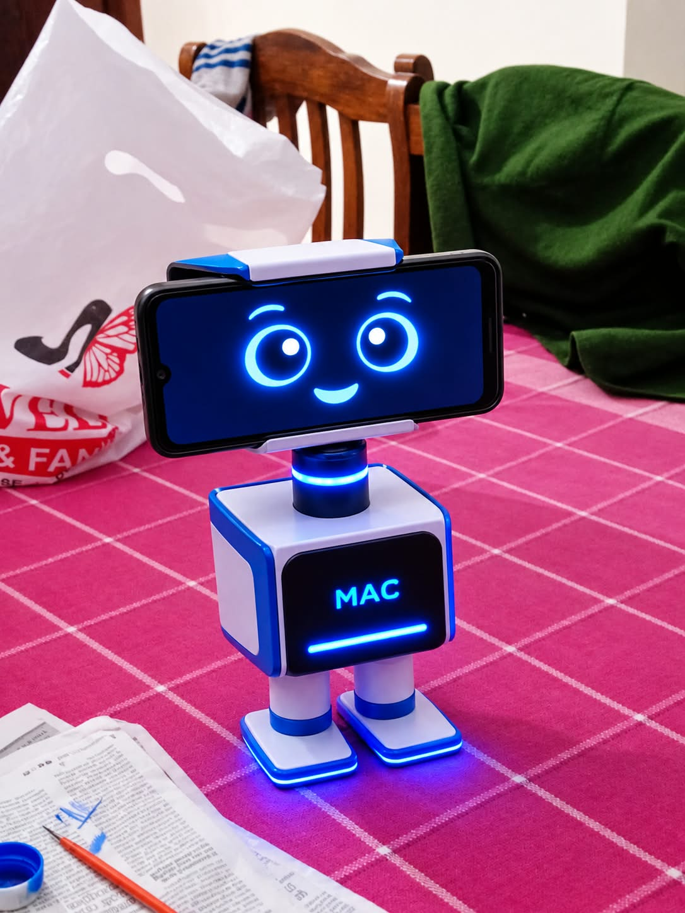

# 🤖 MAC – My Mini AI Companion

  

Meet **MAC**, my first virtual robot companion! Designed for entertainment, communication, learning, and everyday assistance. My goal is to build a friendly and interactive AI companion using modern AI technologies.

## 🚀 Version History

### 🔹 Version 1.0 – Basic Demo
- Created a virtual robot face UI.
- Added predefined questions and answers.
- Implemented voice input and output.

### 🔹 Version 2.0 – Ollama LLM Integration
- Integrated a local LLM using Ollama.
- Enabled open-ended conversations on any topic.
- Added dynamic AI-generated responses.

### 🔹 Version 3.0 – In Progress 🚧
- Developing new AI features.
- Improving interaction and intelligence.

## 🎯 Future Vision
Building a smarter, more interactive, and helpful AI companion.
